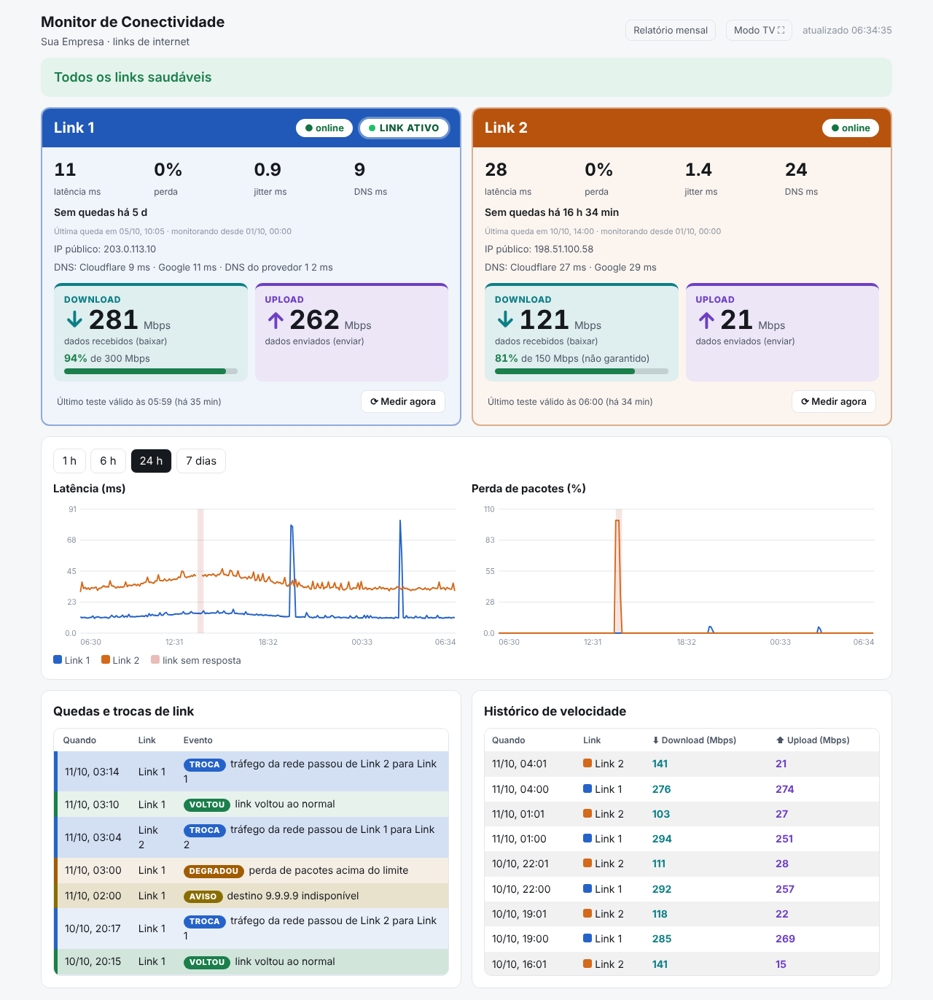
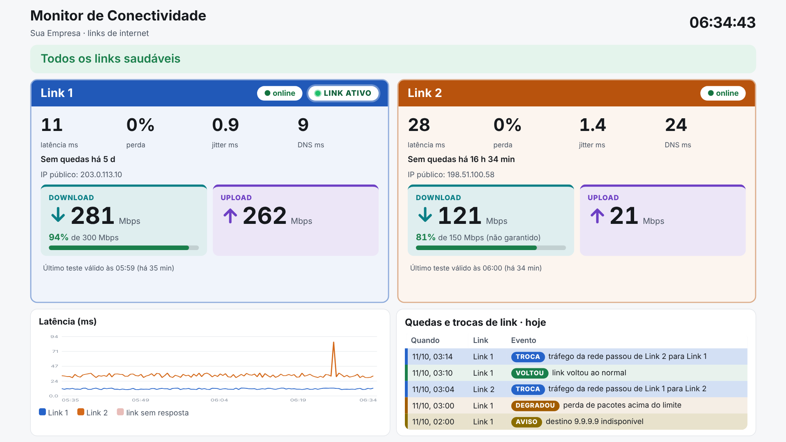
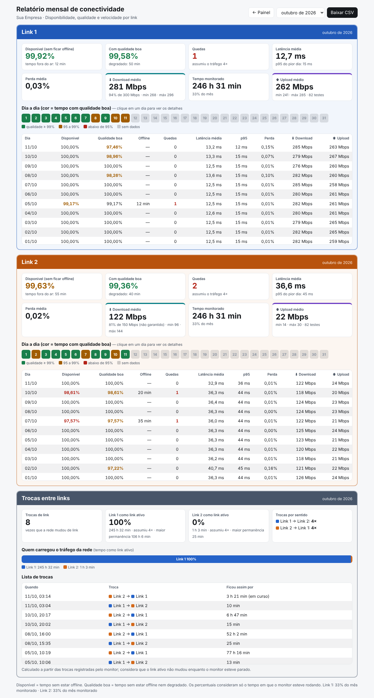
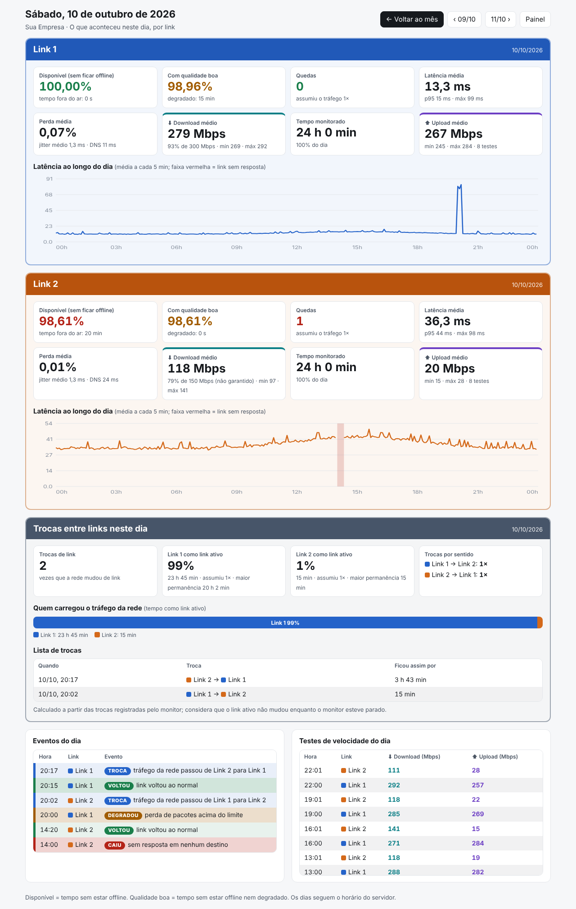
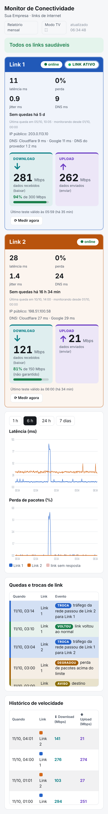

# Connectivity Monitor (link-health-monitor)

[Português](README.md) · **English** · [Español (Honduras)](README.es-HN.md)

A dashboard that shows, in real time, the health of **each internet link separately**: status, latency, packet loss, jitter, DNS, download and upload speed, outages, and link switches. It runs on an internal Linux server, **with no dependency on external monitoring tools** and without installing any libraries (just standard Python and SQLite).



## The problem it solves

When a company has two internet links with failover, a complaint about slowness is often really the primary link being down and traffic running over the backup. Common monitors test the internet "as the network sees it", so they don't show which link is good, which is bad, and when the network switched from one to the other.

This project tests **each link on its own, all the time**, even when network traffic is going through the other one, and keeps the history so you can answer questions like "how many times did the link go down this month?", "how long were we on the backup link?", and "are we getting the speed we pay for?".

## Features

- **Per-link status** (online, degraded, offline) with a majority rule: one test target being down becomes just a warning and does not take the link down.
- **Latency, loss, jitter, and DNS time** across several targets and several DNS servers.
- **Time-based speed test** (stable and calibrated), with the percentage of the contracted speed, automatic every 3 hours and on demand via the "Measure now" button (`Medir agora` in the UI).
- **Active link:** shows which link the network is currently going out through and records every switch.
- **Outages and link switches** in a color-coded list, with a "how long ago" that survives restarts.
- **Monthly report:** availability, quality, outages, speed, a per-day color-coded calendar, a detailed view of each day, a card for switches between links, and CSV export (opens directly in Excel).
- **TV mode:** full screen for a TV in the team room, with a margin adjustment for TVs that crop the edges of the image.
- **Responsive:** works on a laptop, TV, and phone.
- **No dependencies:** a single Python script, one SQLite database, and two HTML pages.

## Screenshots

All images use fictitious data.

| TV mode | Month report |
|---|---|
|  |  |

| Day view | On a phone |
|---|---|
|  |  |

The dashboard also has a dark theme: [`docs/images/painel-escuro.png`](docs/images/painel-escuro.png).

## How it works

```
 Linux server ─ eth0: main IP + test IP A + test IP B
       │
       ▼
 Firewall/router ─ source-based rule: IP A → Link 1,  IP B → Link 2
       │                              │
     Link 1                         Link 2
```

The server gets two secondary IPs. The firewall pins each one to a link, so tests from one IP always go out through the corresponding link. The collector tests each link every 10 seconds (ping, DNS, and public IP) and measures speed every 3 hours. A built-in HTTP server delivers the dashboard and the report. If the firewall diverts a test to the other link, the collector notices from the public IP and marks the link as offline, instead of showing a false "healthy". Details in [`docs/en/architecture-and-rules.md`](docs/en/architecture-and-rules.md).

## Prerequisites

- A Linux server with **Python 3.9 or later** and the `ping` command with `-I` support (iputils package). Tested on Rocky Linux 9 (Python 3.9) and with Python 3.13.
- **Two free IPs on the LAN**, outside the DHCP range, to be used as the source of the tests.
- A **firewall or router with source-based routing** (policy-based routing). There is an example with FortiGate and SD-WAN in [`docs/en/firewall-example-fortigate.md`](docs/en/firewall-example-fortigate.md).
- HTTPS outbound allowed for the test IPs (the tests use `speed.cloudflare.com`, `api.ipify.org`, `icanhazip.com`, `checkip.amazonaws.com`, plus the public DNS servers 1.1.1.1, 8.8.8.8, and 9.9.9.9).

## Quick install

The full step-by-step is in [`docs/en/deployment-and-rollback.md`](docs/en/deployment-and-rollback.md). Summary, as root, from the repository folder:

```bash
mkdir -p /opt/monitor-links
cp src/collector.py src/dashboard.html src/relatorio.html /opt/monitor-links/
cp config/config.example.json /opt/monitor-links/config.json
# edit /opt/monitor-links/config.json (names, source IPs, public IP, speeds)

cp deploy/*.service /etc/systemd/system/
# edit monitor-links-ips.service (test IPs, prefix, and interface)
systemctl daemon-reload
systemctl enable --now monitor-links-ips.service monitor-links.service
```

Open `http://SERVER-IP:8080`. TV mode is at `/?tv=1` (add `&margem=5` if the TV crops the edges) and the report is at `/relatorio`.

## How to validate

```bash
curl --interface 192.0.2.12 -s https://api.ipify.org    # Link 1 public IP
curl --interface 192.0.2.13 -s https://api.ipify.org    # Link 2 public IP
ss -ltnp | grep 8080                                     # dashboard is up
```

The two links must go out through **different** public IPs (replace the example IPs with yours). On the dashboard, both links should show as online, with DNS responding and, after the first measurement, with their speed.

## Common problems

- **Both links show the same public IP, or one link shows as offline even though the internet works.** The firewall is diverting the test to the other link ("diverted test"). Check that each test IP has a source-based routing rule and that the outbound policy allows these IPs.
- **The dashboard stays on "waiting" or shows an address error.** The test IPs don't exist on the interface. Check `ip -4 -brief addr` and the `monitor-links-ips.service` service.
- **"DNS failure" or "HTTP 403" in the speed test.** The test server refuses some file sizes. The collector already tries smaller sizes (`velocidade_tamanhos_reserva_mb`), but check the HTTPS outbound access of the test IPs.
- **The measured speed is lower than the contracted speed.** Increase the link's `velocidade_conexoes` (more parallel connections) and compare against a reference tool. Links without guaranteed speed naturally vary.
- **"Measure now" answers "wait".** That is the lock between measurements (`medir_agora_intervalo_s`, default 300 s).
- **The dashboard times are wrong.** The dashboard uses the browser's clock. Check the date, time, and time zone of the computer opening it.
- **TV mode crops the edges.** This is usually the TV's *overscan*: choose "Just Scan" in the picture format setting or use `/?tv=1&margem=5`.
- **The "ACTIVE LINK" badge takes a while after a restart.** It takes about 40 s: the collector confirms the link in use after two identical readings.

## Security

The dashboard, the "Measure now" button, the report, and the CSV have **no login**. Keep access restricted to the internal network, preferably behind a reverse proxy that only accepts private addresses, with a name in the internal DNS (no record in public DNS). Speed tests consume a few hundred MB per measurement: take that into account if any link has a data cap.

## Notice: fictitious data

All IP addresses, names, identifiers, and values in this repository and in the images are **fictitious**. The IPs use the ranges reserved for documentation (192.0.2.0/24, 198.51.100.0/24, and 203.0.113.0/24) and "Sua Empresa" is an example name. Replace everything with the values from your environment. Do not publish your `config.json` or your `monitor.db`: they are in `.gitignore` for that reason.

## Documentation

- [Architecture and operating rules](docs/en/architecture-and-rules.md)
- [Deployment, update, and rollback](docs/en/deployment-and-rollback.md)
- [Firewall example: FortiGate with SD-WAN](docs/en/firewall-example-fortigate.md)
- [Version history](CHANGELOG.md)

## How to contribute

Contributions are welcome. Open an *issue* to report a problem or suggest an improvement (state your firewall, Linux distribution, and Python version, without pasting real IPs or names). To change the code, make a *fork*, create a branch, and open a *pull request* explaining what changed and how you tested it. The code is standard Python and the pages are HTML with plain JavaScript, with no build step.

## License

Distributed under the **GNU General Public License v3.0** (GPL-3.0). See the [LICENSE](LICENSE) file.
Copyright (C) 2026 Manuel Pérez.
